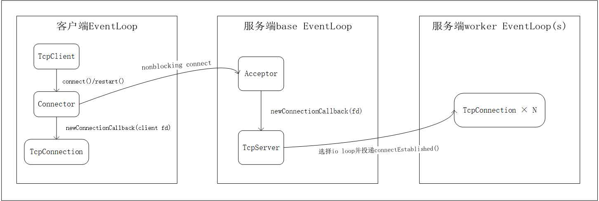
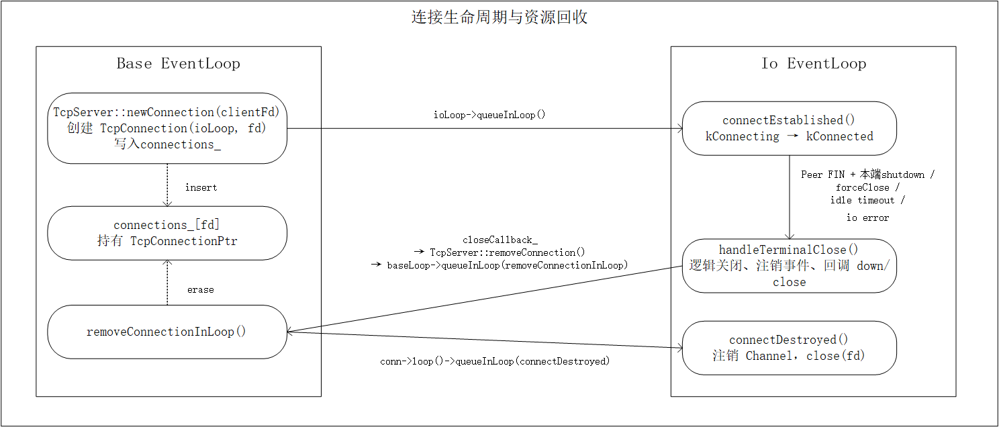
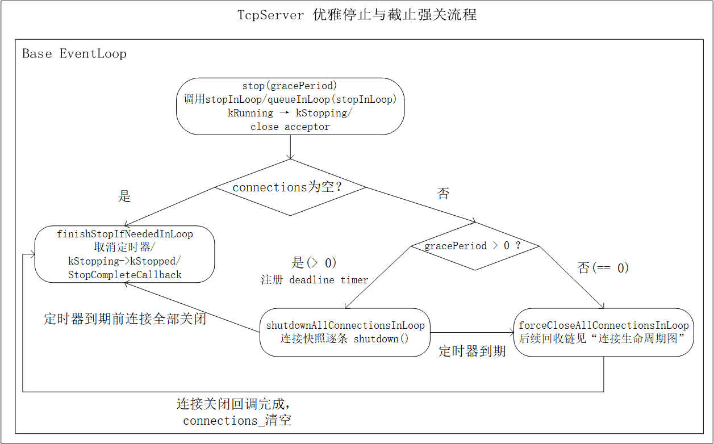

# 一个基于 C++17、epoll 与 Reactor 模式实现的轻量级 TCP 网络库：提供多线程 TcpServer、异步 TcpClient（可选自动重连）以及线程安全的延时/周期任务调度。

## Features

- 基于 `epoll` 的 Reactor 事件驱动模型，支持非阻塞 I/O。
- 提供 `EventLoop`、`Channel` 与 `EpollPoller`，将事件注册、分发和处理解耦。
- 提供单线程或多线程 `TcpServer`；连接可按轮询方式分配到 worker EventLoop。
- 提供异步 `TcpClient`，支持连接、停止未完成连接、优雅断开和可选自动重连。
- 使用输入/输出缓冲区处理 TCP 粘包、半包、部分读写及 `EAGAIN`。
- 支持连接半关闭、优雅关闭、强制关闭，以及服务端带宽限期的停止流程。
- 支持空闲连接超时、一次性延时任务和周期任务。
- 支持高/低水位回调与暂停/恢复读事件，为应用层流量控制与背压策略提供基础机制。
- 提供长度字段编解码器 `LengthHeaderCodec`。
- Acceptor 处理 `EMFILE` 场景，避免监听 socket 因 fd 耗尽而失效。


## 架构与关键设计

### 线程模型与连接建立/分发


该图展示了客户端连接建立，以及服务端对新连接的线程分发过程。
服务端 base EventLoop 中的 Acceptor 在监听 fd 可读时从全连接队列 accept 客户端 fd。
TcpServer 通过 EventLoopThreadPool 轮询选择一个 io EventLoop，创建并保存 TcpConnectionPtr，
随后向目标 io loop 投递 connectEstablished()，由该 io loop 负责连接后续的 I/O 事件处理。


### 连接生命周期与资源回收


该图展示了服务端 TcpConnection 的创建、逻辑关闭和物理资源回收路径。
Acceptor 触发 TcpServer::newConnection() 后，base EventLoop 选择一个 io EventLoop，
创建 TcpConnection 并将其保存到 connections_，再向目标 io loop 投递 connectEstablished()。

对端半关闭且本端完成 shutdown、连接空闲超时、致命 I/O 错误或 forceClose()
都会使连接进入 handleTerminalClose()：注销事件并触发 down/close 回调。
closeCallback 将回收任务投递回 base EventLoop 以擦除 connections_；
随后再投递到连接所属 io loop 执行 connectDestroyed()，注销 Channel 并关闭 fd。


### TcpServer 优雅停止与截止强关流程


该图描述 TcpServer 的停止流程。调用 stop(gracePeriod) 后，若调用方位于 base EventLoop 线程，则直接执行 stopInLoop()；否则将该任务投递到 base EventLoop。

stopInLoop() 会先永久关闭 Acceptor，阻止新连接进入。若 connections_ 已为空，则调用 finishStopIfNeededInLoop()：将状态切换为 kStopped、取消仍存在的截止定时器，并执行 StopCompleteCallback。

若仍有连接：当 gracePeriod > 0 时，注册截止定时器，并对连接快照逐条调用 shutdown()，等待连接优雅关闭；截止定时器到期后，调用 forceCloseAllConnectionsInLoop() 强制关闭剩余连接。若 gracePeriod == 0，则直接调用 forceCloseAllConnectionsInLoop()。

每条连接关闭后会经由其关闭回调从 connections_ 移除；当 connections_ 最终为空时，finishStopIfNeededInLoop() 完成 TcpServer 的停止流程。


## 构建与测试

### 环境要求

- Linux（使用 epoll、eventfd 与 timerfd）

- CMake ≥ 3.20

- 支持 C++17 的编译器

- pthread


### 编译

``` bash
cmake -S . -B build -DBUILD_TESTING=ON
cmake --build build --parallel
```


### 运行测试

``` bash
ctest --test-dir build --output-on-failure
```


## 运行示例

构建完成后，启动一个使用两个 worker EventLoop 的回显服务端：

```bash
./build/multi_thread_echo
```

服务端监听 `0.0.0.0:2007`。在另一个终端连接：

```bash
nc 127.0.0.1 2007
```

输入任意文本并回车，客户端将收到服务端返回的相同内容。


## 项目结构

``` text
src/          核心库实现与头文件
examples/     可运行示例
tests/        单元与集成测试
docs/images/  README 架构图
CMakeLists.txt 构建入口
```